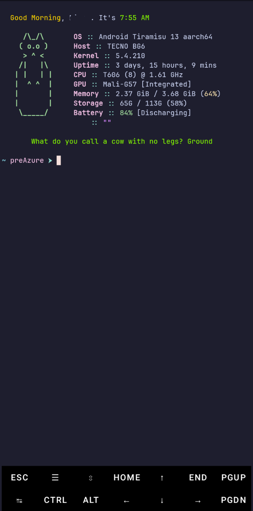

# preAzure

A lightweight Termux fetch dashboard for Android. On every login or `clear`/`x`, it displays a time-based greeting, a random ASCII cat, system info via [fastfetch](https://github.com/fastfetch-cli/fastfetch), and a cached dad joke from [icanhazdadjoke.com](https://icanhazdadjoke.com).

## Features

- **Time-based greeting** — Greets you by time of day (Morning/Afternoon/Evening/Night) with customizable colors and name
- **Random ASCII cats** — Rotates between 6 premade cat ASCII art pieces
- **System info** — Displays OS, Host, Kernel, Uptime, CPU, GPU, Memory, Storage, and Battery using fastfetch with a Catppuccin Mocha-inspired theme
- **Dad jokes** — Fetches jokes from icanhazdadjoke.com, centers them nicely, and caches them for 5 minutes
- **Custom fish prompt** — Clean prompt showing `~ preAzure ➤`
- **Auto-refresh on clear** — Running `clear` re-runs the entire dashboard

## Requirements

- [Termux](https://github.com/termux/termux-app) installed from **[F-Droid](https://f-droid.org/packages/com.termux/)** (not the Google Play Store). Signatures must match or styling won't apply properly.
- Android 7+ (aarch64)
- Internet connection (for fetching dad jokes; cached after first fetch)

## Installation

### 1. Clone the repository

```bash
git clone https://github.com/jzrxl/preAzure.git
cd preAzure
```

### 2. Run the installer

```bash
bash install.sh
```

The installer will:
- Install required packages (`fish`, `fastfetch`, `bat`, `fzf`, `eza`, `zoxide`, `termux-api`, `git`, `jq`, `nano`, `unzip`, `curl`)
- Set `fish` as your default shell
- Install preAzure scripts to `~/.local/bin/`
- Copy configuration files to `~/.config/preAzure/` and `~/.config/fastfetch/`
- Install ASCII cats to `~/.config/fastfetch/cats/`
- Install fish config and custom functions
- Apply Termux color scheme
- Add `~/.local/bin` to your PATH

### 3. Install a Nerd Font (required)

The installer does **not** install fonts automatically. You'll need a Nerd Font for proper icon/glyph rendering.

1. Download `JetBrainsMonoNerdFontMono-Regular.ttf` (the **Mono** variant) from the [Nerd Fonts releases page](https://github.com/ryanoasis/nerd-fonts/releases).
2. Copy it to your Termux font directory:

```bash
cp /storage/emulated/0/Download/JetBrainsMonoNerdFontMono-Regular.ttf ~/.termux/font.ttf
```

3. Verify the file is ~2.4 MB.
4. Force-stop Termux from Android Settings → Apps → Termux, wait 10 seconds, then reopen it.

### 4. Verify font installation

Test that glyphs render correctly:

```bash
printf '\ue0b0 \ue0b2 \uf17b \uf303 \ue0b3\n'
```

- **Real glyphs** = Success!
- **Boxes/question marks** = Wrong font variant (make sure you downloaded the *Mono* variant, not the proportional one)

### 5. Launch

```bash
exec fish && preAzure
```

## Screenshot



*Note: The greeting in the screenshot may contain offensive language.*

## Configuration

Edit `~/.config/preAzure/config.sh` to customize your dashboard:

| Variable | Default | Description |
|---|---|---|
| `GREET_NAME` | `friend` | Name displayed in the greeting |
| `TIME_COLOR` | `118` | Color for the clock/time (256-color) |
| `GREET_MORNING_COLOR` | `220` | Greeting color for 5:00 AM - 11:59 AM |
| `GREET_AFTERNOON_COLOR` | `208` | Greeting color for 12:00 PM - 4:59 PM |
| `GREET_EVENING_COLOR` | `177` | Greeting color for 5:00 PM - 9:59 PM |
| `GREET_NIGHT_COLOR` | `111` | Greeting color for 10:00 PM - 4:59 AM |
| `JOKE_COLOR` | `118` | Color for the dad joke text (256-color) |
| `JOKE_ENABLED` | `1` | Set to `0` to disable dad jokes |
| `CAT_ENABLED` | `1` | Set to `0` to disable the ASCII cat |
| `JOKE_TTL` | `300` | Joke cache duration in seconds (default: 5 minutes) |

See the [256-color cheat sheet](https://www.ditig.com/256-colors-cheat-sheet) for color codes.

## Usage

- **On login** — The dashboard runs automatically when you open Termux with fish as your shell
- **Refresh** — Run `clear` or `x` to re-run the dashboard with a new random cat and potentially a fresh joke (if cache expired)

## Uninstall

```bash
bash uninstall.sh
```

## License

[WTFPL](LICENSE) - Do What The F*ck You Want To Public License
